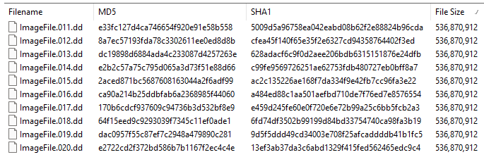
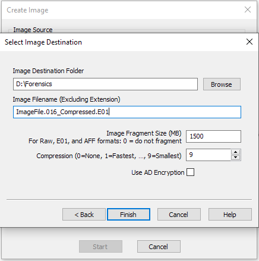
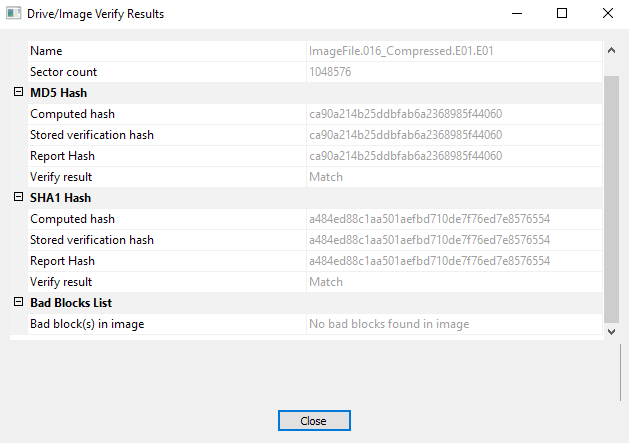
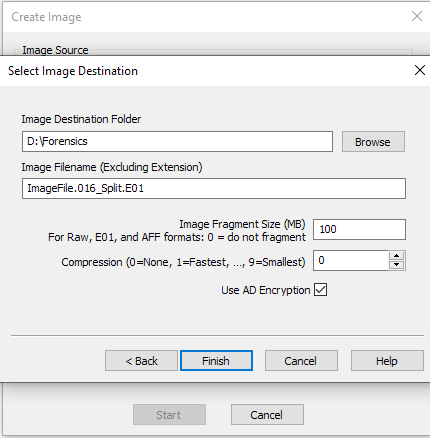
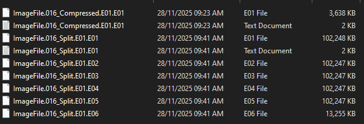
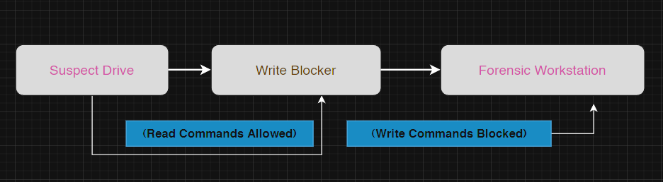
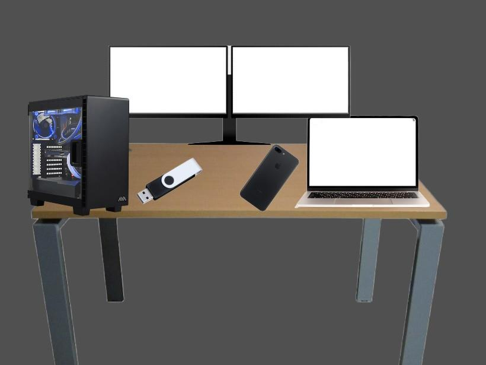
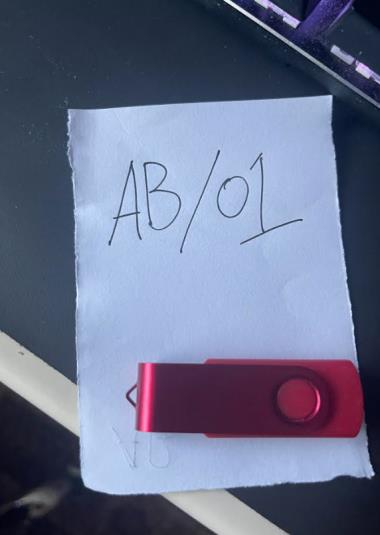
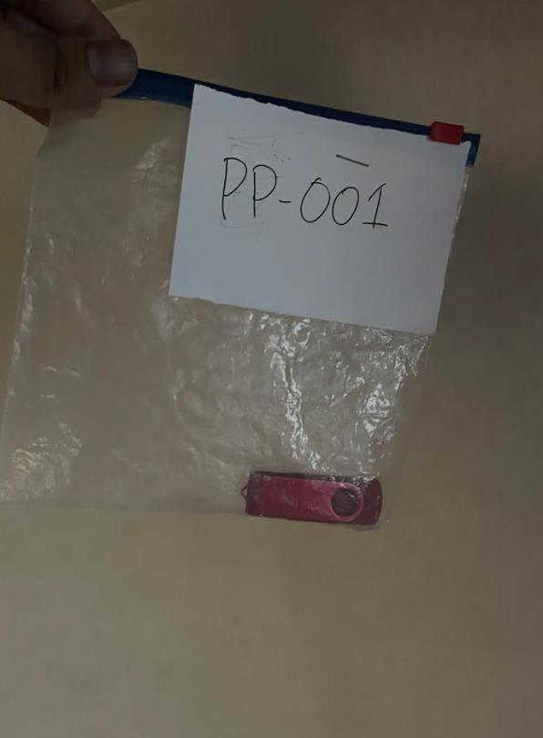

# Digital Forensics Investigation

A write-up of the methods I used in an individual digital forensics investigation for my Computer Forensics module (University of Greenwich, final year, November 2025). The work followed a case from start to finish: securing a digital crime scene, imaging and verifying evidence, examining a USB drive image to answer questions from the prosecution, and presenting the results as an expert witness statement.

> This write-up covers how I worked and the tools I used. It leaves out the case details, the evidence I found and my conclusions, because the case material belongs to the university and may be used again for other students.

## Tools

| Tool | What I used it for |
|---|---|
| FTK Imager | Creating and verifying E01 forensic images, browsing the file system, viewing files and timestamps |
| Autopsy | Keyword searches, recovering deleted files from the Recycle Bin, reviewing files and metadata |
| HashMyFiles | Calculating MD5 and SHA1 hashes to verify evidence integrity |

## 1. Evidence acquisition and verification

- **Checked the source image:** calculated the MD5 and SHA1 hashes of the raw `.dd` image with HashMyFiles and compared them with the official values, to confirm I was working with the correct, unaltered copy.
- **Created a compressed E01 image:** used FTK Imager to convert the raw image to the Expert Witness (EWF/E01) format at maximum compression (level 9). FTK Imager then checked the new image against its stored MD5 and SHA1 hashes, and both matched.
- **Created a split E01 image:** made a second E01 image split into 100 MB segments with no compression, producing six segments (E01 to E06). Each segment was verified with no errors or bad blocks.
- **Verified with a second method:** used FTK Imager's Verify Image feature, then mounted the image as an evidence item to confirm the file system, partitions and deleted files could all be read. Checking the same evidence two ways shows the image is forensically sound.
- **Write blockers:** explained how hardware and software write blockers allow read commands but block writes, so the operating system can't change metadata or timestamps on the original media, and why hardware blockers are preferred in professional settings.

## 2. Digital crime scene search

I documented the search of a simulated digital crime scene, following NPCC (formerly ACPO) guidance:

- **Safety assessment** before the search, covering hazards, cables, liquids and exits
- **Roles** at the scene: seizing officer, photographer, evidence recorder and scene manager
- **The four ACPO principles:** don't change data, justify any access, keep an audit trail, and the examiner is responsible for legal compliance
- **Ethics and bias:** no assumptions about the device owner, only recording what was visible, and only seizing items able to store or create digital data
- **Evidence handling:** photographed each item where it was found (in situ), gave each one an exhibit reference, bagged and sealed it, and recorded it on a **chain of custody** log
- **GDPR and privacy:** no devices powered on, no unrelated personal material accessed or photographed

## 3. Examining the evidence

I examined a forensic image of a USB drive (NTFS file system) to answer a set of questions from the Crown Prosecution Service. My approach was to:

1. Verify the supplied E01 image before starting
2. Use **Autopsy keyword searches** to find documents linked to the people named in the case
3. **Recover deleted files** from the Recycle Bin
4. Browse the folder structure in FTK Imager and Autopsy, reviewing file types, sizes and **MAC timestamps** (modified, accessed and created) to build a timeline
5. Look for **disguised files**, where a file's content didn't match its name
6. Identify **anti-forensic and concealment tools** stored on the drive, such as steganography software and a hex editor
7. Bring the evidence together to form a reasoned opinion on who owned the device

## 4. Reporting as an expert witness

I presented the findings in an **MG11 witness statement**, the format used in UK criminal cases. Writing it covered:

- Summarising findings for each question, then giving detailed findings with file paths, timestamps and the tool used for each item, so another examiner could repeat the work
- Separating facts from opinion, and explaining the reasoning behind the ownership opinion
- Disclosure duties under the Criminal Procedure and Investigations Act 1996
- The expert's duty to the court, and the Forensic Science Regulator's Code of Conduct

## Evidence of my work

### Imaging and verification results

| Step | Tool | Setting | Result |
|---|---|---|---|
| Check the source `.dd` image | HashMyFiles | MD5 and SHA1 | Both matched the official values |
| Create a compressed E01 | FTK Imager | EWF format, compression level 9 | MD5 and SHA1 verification: **Match** |
| Create a split E01 | FTK Imager | 100 MB fragments, compression 0 | 6 segments (`.E01` to `.E06`), all verified, no errors or bad blocks |
| Verify with a second method | FTK Imager: Verify Image | Stored hashes inside the E01 | MD5 and SHA1: **Match** |
| Check the image can be read | FTK Imager: Add Evidence Item | Mounted the compressed E01 | Partitions, folders and deleted files all readable |

**Hashing the source images with HashMyFiles**

**Creating the compressed E01 in FTK Imager (compression level 9)**

**Verification result: MD5 and SHA1 both "Match", no bad blocks**

**Creating the split E01 (100 MB fragments, no compression) and the six segments it produced**

**How a write blocker protects evidence**

### Crime scene search

**Safety assessment before the search**
- No immediate hazards visible
- No liquids on the desk
- Electrical cables present but not exposed or damaged
- All devices in their original state and powered off
- No sharp or dangerous items
- Access and exit routes clear

**Exhibits seized and chain of custody**

| Exhibit ref | Description | Location | Seized by |
|---|---|---|---|
| AB/01 | USB flash drive | Desk | PP |
| AB/02 | Mobile phone | Desk | PP |
| AB/03 | Laptop | Desk | PP |
| AB/04 | PC | Desk | PP |
| AB/05 | Notebook | Desk | PP |

Each exhibit was photographed in situ, labelled, then bagged and sealed.

**Scene diagram**

**Exhibit AB/01 labelled in situ, then bagged and sealed**

### Witness statement structure

My MG11 statement followed this structure:

1. Qualifications and experience
2. Background to the case and verification of the supplied image
3. Questions set by the Crown Prosecution Service
4. Summary of findings
5. Detailed findings for each question, with file path, timestamps and the tool used
6. Opinion on ownership of the device, with reasons
7. Disclosure under the Criminal Procedure and Investigations Act 1996
8. Duty to the court and the Forensic Science Regulator's Code of Conduct

## What I learned

The biggest lesson was that in forensics, being able to prove the evidence hasn't changed matters as much as what you find. Hashing at every step, verifying with two methods and keeping a chain of custody are what make findings stand up in court. Writing a witness statement also taught me to report findings so they are clear, can be repeated and stay neutral.

## Skills

Digital forensics, evidence acquisition and verification, hashing (MD5/SHA1), E01 imaging, deleted file recovery, timeline analysis, chain of custody, NPCC/ACPO guidelines, GDPR, and writing expert witness reports.
